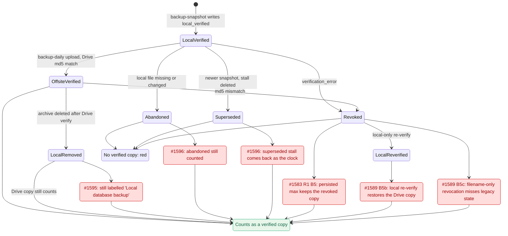
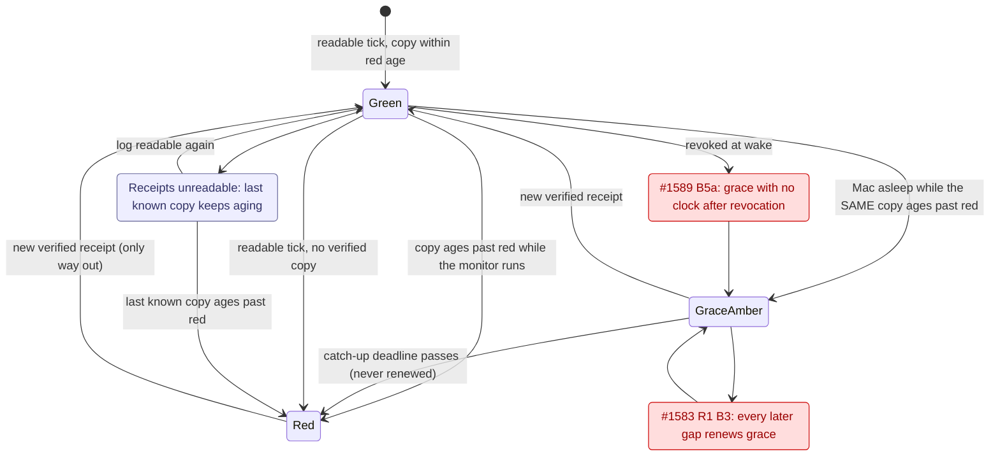
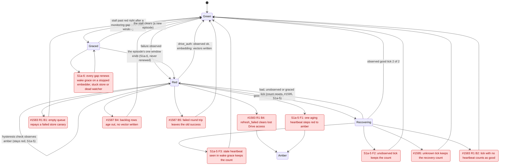
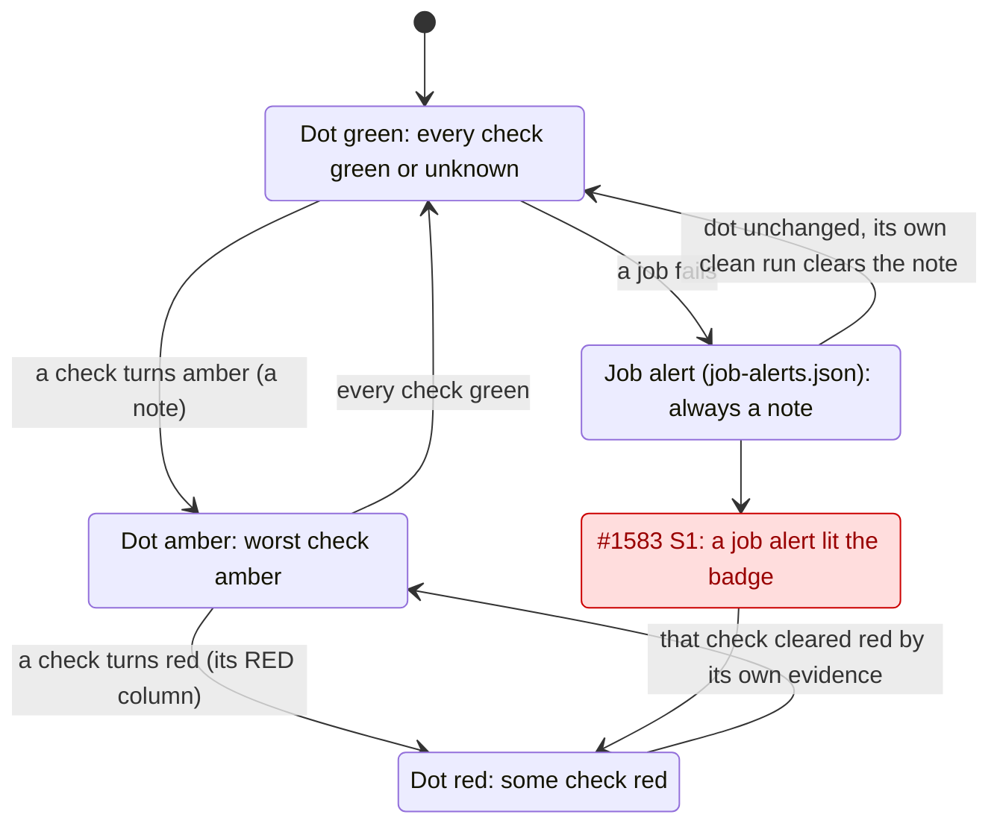

# Backup → snapshot → VACUUM → dot: state diagram

Every red box sits on a transition TLC walked when a pre-fix switch was on. Each one is labelled
with the PR that removed it, and its counterexample is in [COUNTEREXAMPLES.md](COUNTEREXAMPLES.md).
The three `S1a-5` boxes are bugs this model found itself (F1–F3), fixed by S1a-5 (4e07651b). The
`S1a-6` box is renewable wake grace, found by the R1 review once the model took the real
`_graced_age` path, and fixed by S1a-6 (8eecb5ee). Neither fix is on main yet. Run `formal/backup-verdict/check.sh` to reproduce every box.

## 1. Receipts and the snapshot check (`BackupVerdict.tla`)

## 2. One backup check across a monitoring gap (`BackupVerdict.tla`)

The blue box is a design limit, not a bug. A receipt appended while the log is unreadable cannot be
seen, so the dot trusts the last copy it knew until that copy ages out (case `limit-unreadable-log`).

## 3. Latched and hysteresis checks (`PipeVerdict.tla`)

## 4. The dot (`DotTable.tla`, plan §3d)

### Every dot state (plan §3d), and where it is checked

| Check | GREEN | AMBER (note) | RED (dot) | What clears red | Checked in |
|---|---|---|---|---|---|
| `backup_local` "Database snapshot (verified)" | ≤ 30 h | 30–54 h | > 54 h, or none | a new verified receipt | `BackupVerdict` NoFalseGreen, RedHoldsUntilEvidence, TruthfulSnapshotLabel |
| `backup_offsite` | ≤ 30 h | 30–78 h | > 78 h | a new verified upload | `BackupVerdict` NoFalseGreen, RedHoldsUntilEvidence |
| `transcripts` | ≤ 30 h | 30–54 h | > 54 h | a new verified transcript backup | `DotTable` aging class (same `_verified_age` path as the two above, not separately modelled) |
| `drive_auth` | ok | refresh failed | consent needed | an observed `ok` | `PipeVerdict` Focus=drive |
| `integrity` | ok | — | corrupt | a clean result | `DotTable` two-state class |
| `ingest` | fresh | > 10 min | > 30 min | 2 consecutive good ticks, advancing heartbeat | `PipeVerdict` Focus=ingest (S1a-5 F1–F3; conformance vs real code) |
| `embedding` | progressing | — | not shrinking > 6 h | vectors written | `PipeVerdict` Focus=embedding (S1a-6 grace; conformance vs real code) |
| `stores` | ≤ 15 min, canary ok | 15–45 min or 1 fail | > 45 min or 3 fails | canary success, then 2 good ticks | `PipeVerdict` Focus=stores (S1a-6 grace; conformance vs real code) |
| `search` | ok | 1–2 fails | 3 fails | 2 consecutive good ticks | `DotTable` hysteresis class |
| `disk` | ≥ peak + 2× floor | < peak + 2× floor | < peak | space recovered | `DotTable` aging class |
| `monitor` | — | 3+ blind ticks | never | a good observation | `DotTable` MonitorNeverRed |
| job alerts | — | always a note | never | their own next clean run | `DotTable` NoStuckAlert, AlertClears |
