# Pipeline bubble placement and Jobs label

Before source: `b404bbb40c9db08b3b00b95d1338b793cae6fcba`. After source: `03b7df4c26ebaa5c57cf5c4be40647342c52a702`.

Invented fixtures rendered offscreen with NDRenderHarness. No app was launched; no owner data or screenshots were used.

The card and window height do not grow. Agents uses the nearest legal body position when centring would cross the card edge. Save queue uses a narrower full-content panel. Search uses a full-content panel farther left, with its notch still on Search. The orange outline marks the deliberately short visible frame.

| State | Before | After |
|---|---|---|
| agents-dark |  | 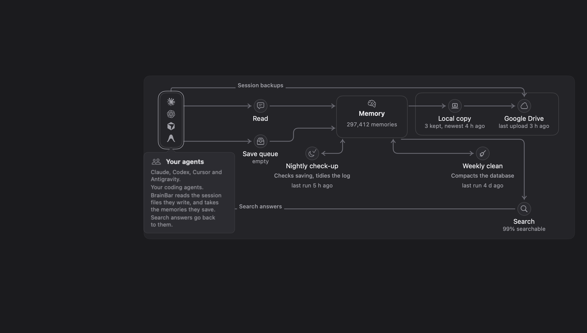 |
| agents-light |  | 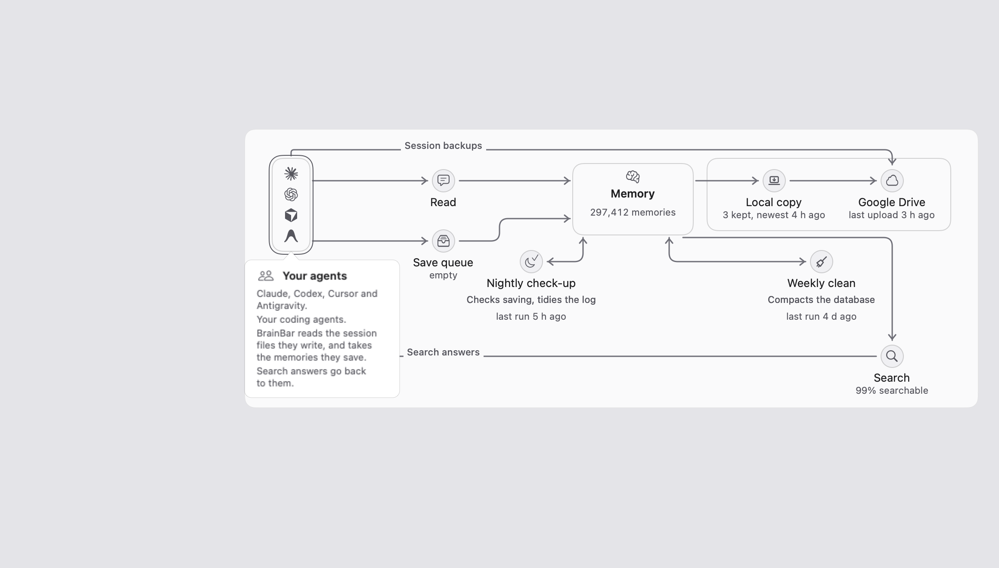 |
| queue-dark | 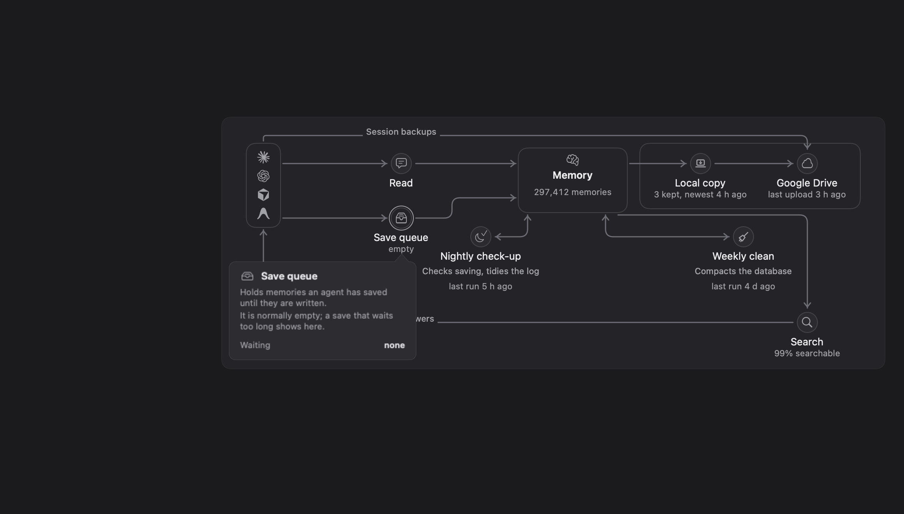 | 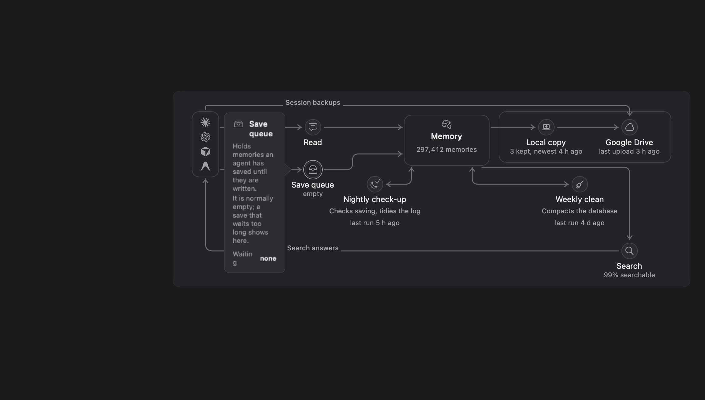 |
| queue-light | 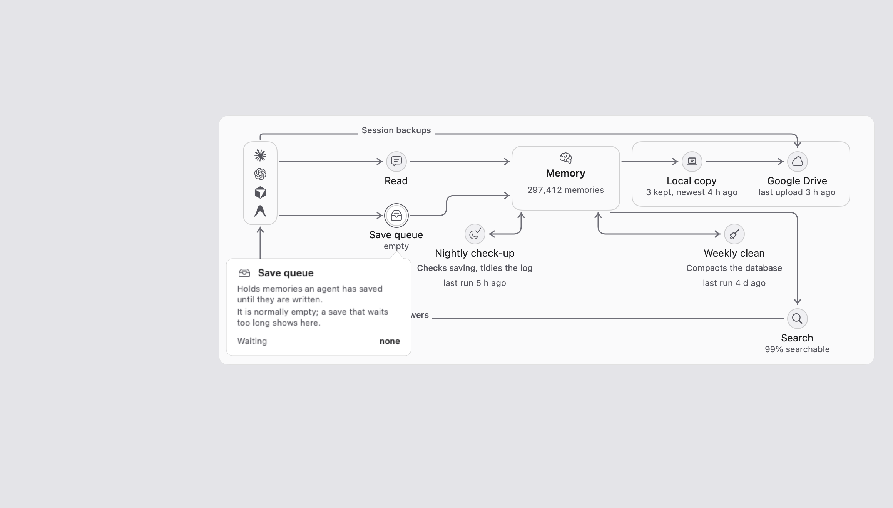 | 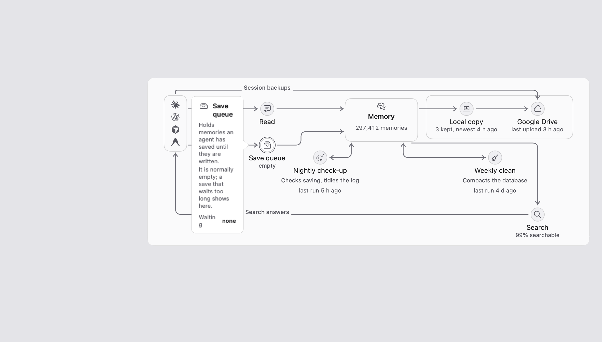 |
| search-dark | 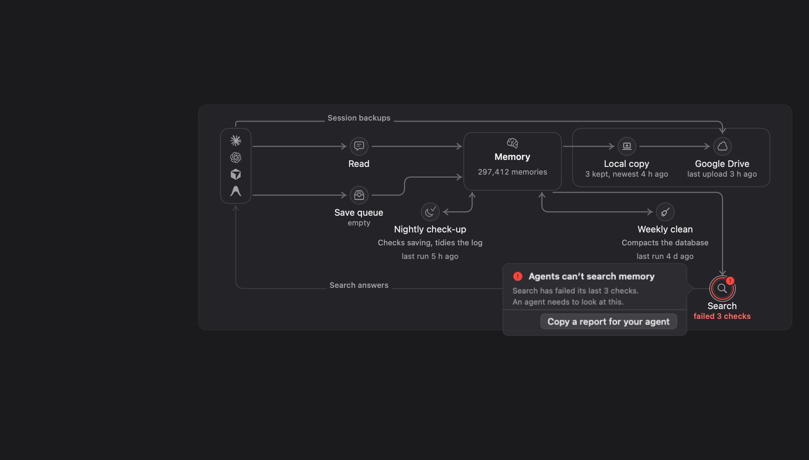 | 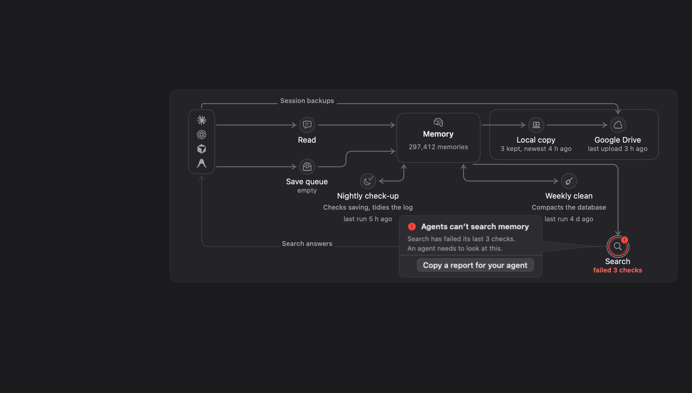 |
| search-light | 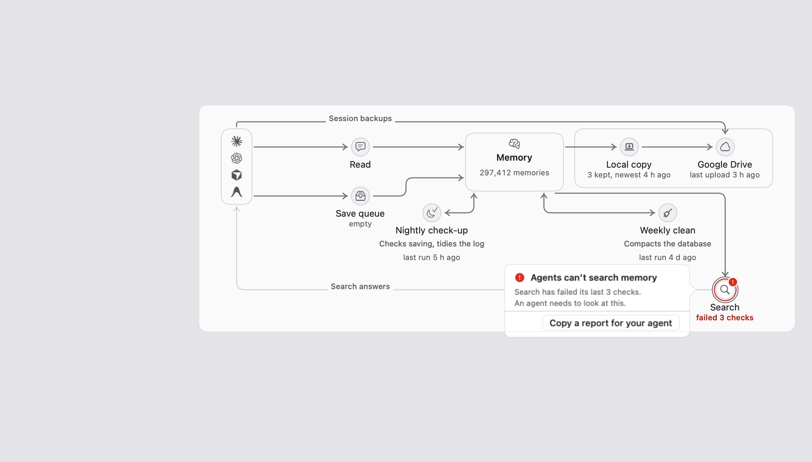 | 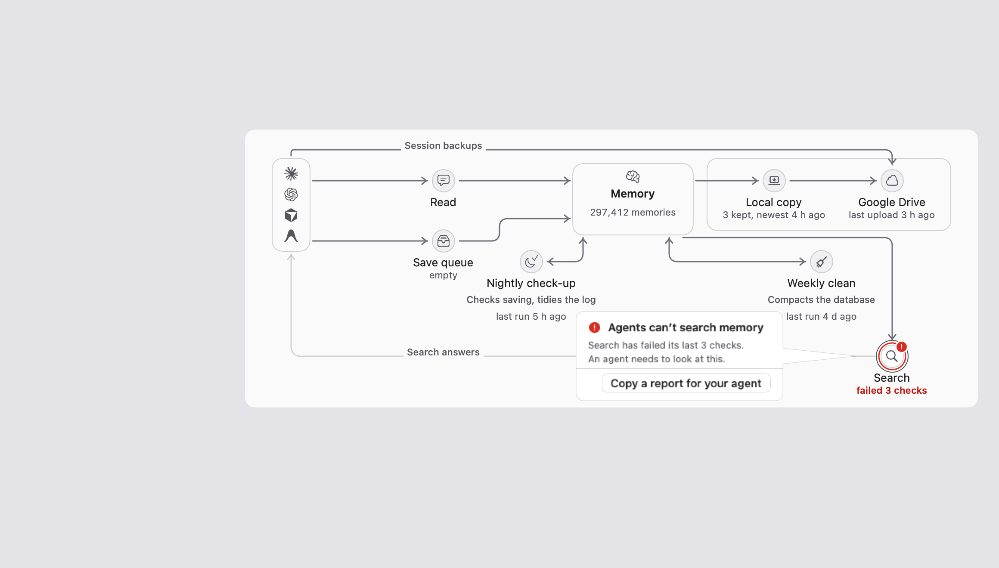 |
| older-NSAppearanceNameDarkAqua |  |  |
| older-NSAppearanceNameAqua |  |  |
| short-screen-dark | 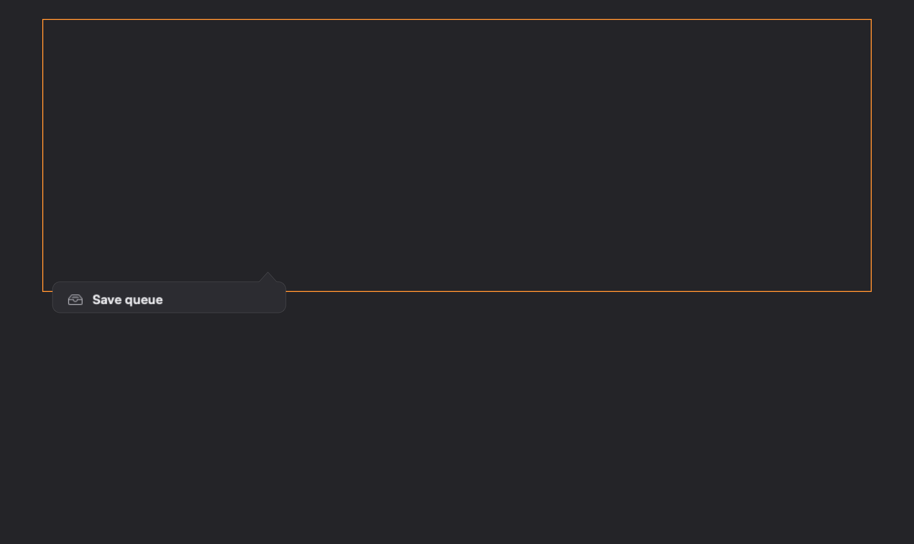 | 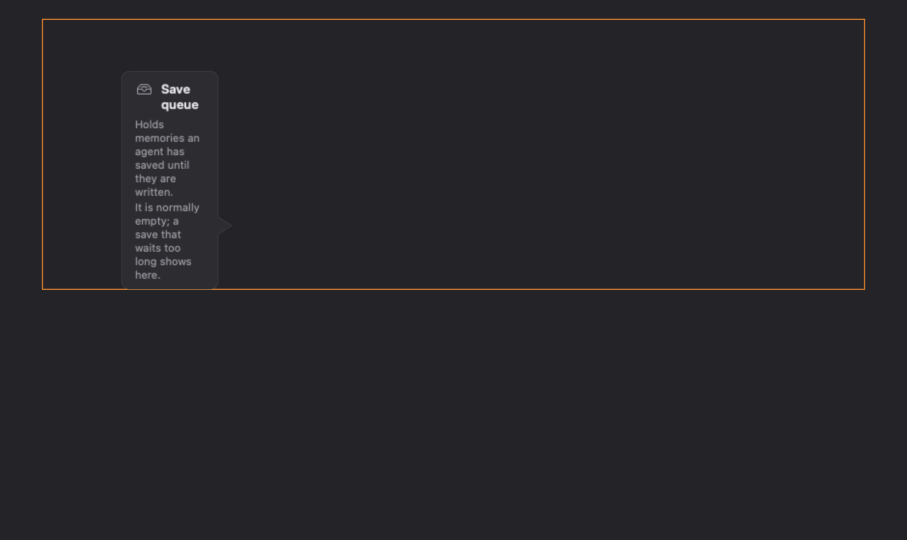 |
| short-screen-light | 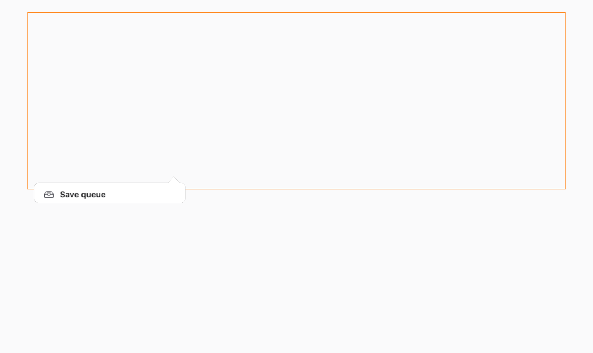 | 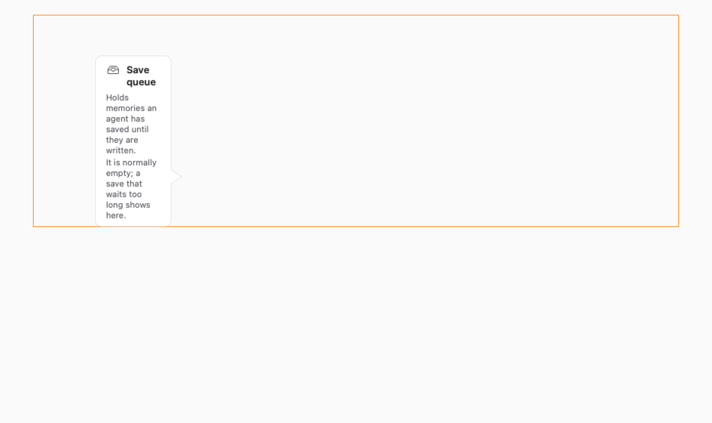 |

## Verification

The original implementation failed 71 assertions across five focused tests, including pixel failures in both themes. The fixed implementation is checked for measured content fit, card/screen bounds, station/notch clearance, caption preservation and actual label ink before the rail.

Run the focused `BrainBarBubblePlacementTests` with `BUBBLE_PLACEMENT_PROOF` pointing inside the worktree to regenerate these views. The first-look and pipeline-space suites cover the neighbouring placements.

Native pointer traversal and installed-app acceptance remain for the lead on M1. These pictures are offscreen source proof.
