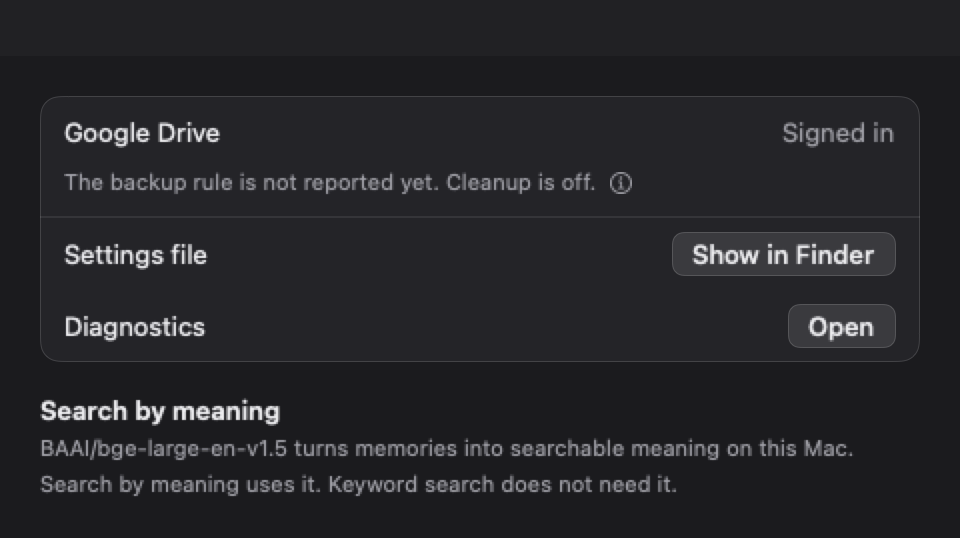
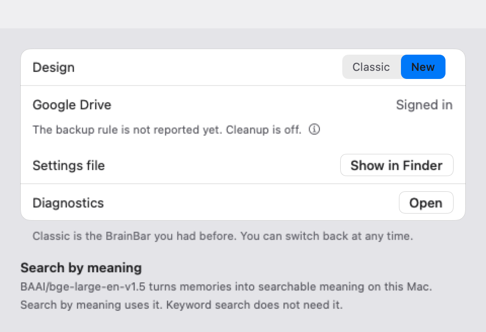
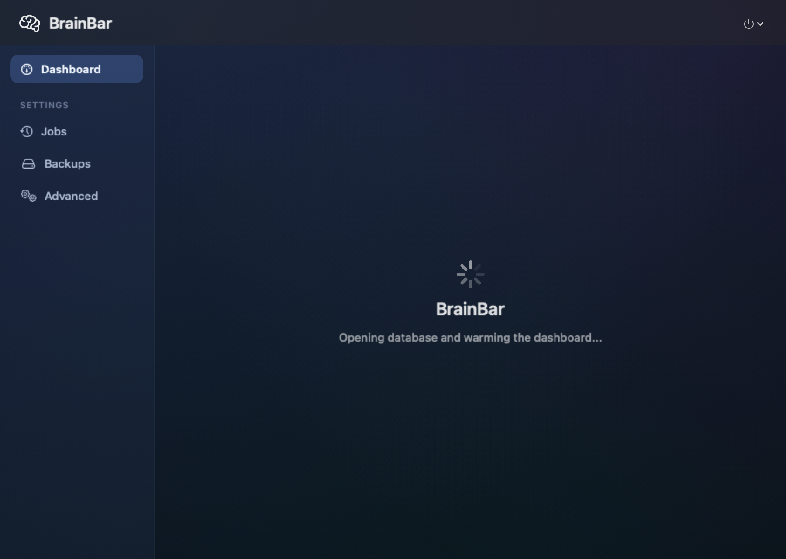

# BrainBar: New is the only app design

Source commit: `8909073145318fc6755147c4c253fc2c500062fe`. Baseline resolver/Settings/wording: `07720cbbacba43abfb25ca0414eb5dafaf5e0245`.

All inputs are invented. These are offscreen `NDRenderHarness.host` renders, not a running installed app or native window capture.
Settings uses the view's fitting height at its fixed native 480-point width. The initial-window views use their native widths/heights (900 points wide). There is no mobile/390-point app layout.

| State | Before | After |
|---|---|---|
| Settings, dark |  |  |
| Settings, light |  |  |
| Stored `BrainBarDesign=classic`, initial window, dark |  |  |
| Stored `BrainBarDesign=classic`, initial window, light |  |  |

## Method and evidence boundary

The original `BrainBarDesign.swift`, `NDSettings.swift` and `BrainBarMenuSentences.swift` were restored from the baseline for the before run. Other files remained on the implementation branch. The retained Classic initial root is unchanged; its nil-collector state renders a loading view and starts no collector, database or socket. The after run renders New's equivalent unconfirmed initial state from an invented `BrainBarMenuCapture`.

`selected-root-render-test.swift.txt` preserves the temporary baseline-compatible selection renderer. Its Classic render arm is removed from the committed regression test. The app's actual controller has separate New-only root/page-sizing integration coverage for CI; those window tests were not run on the owner's desk.

The baseline ran 3 tests with 12 expected assertion failures (stored preference resolution and OCR of Settings/selected root). The implementation ran the same checks with 0 failures. The final focused set passed 73 tests; the truth test enumerated 47,257 captures. No full Swift suite, installed-app or native acceptance claim is made.

All eight PNGs were opened and visually inspected. The production Settings loses its Design selector and switch-back caption. New's other shipping views retain their rendering; a DEBUG-only backup fixture's Classic-card substitution was also removed.
