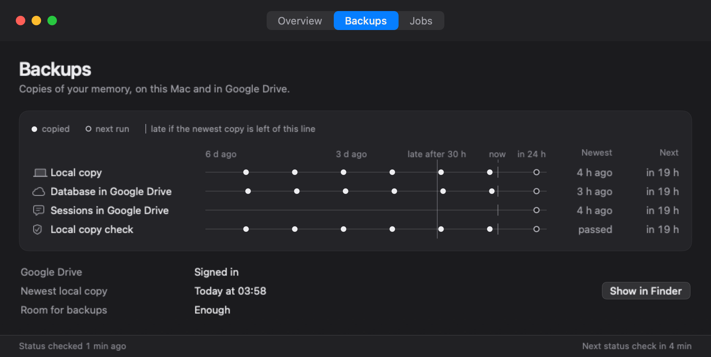
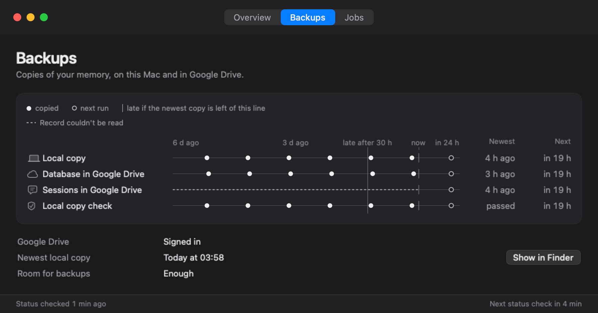
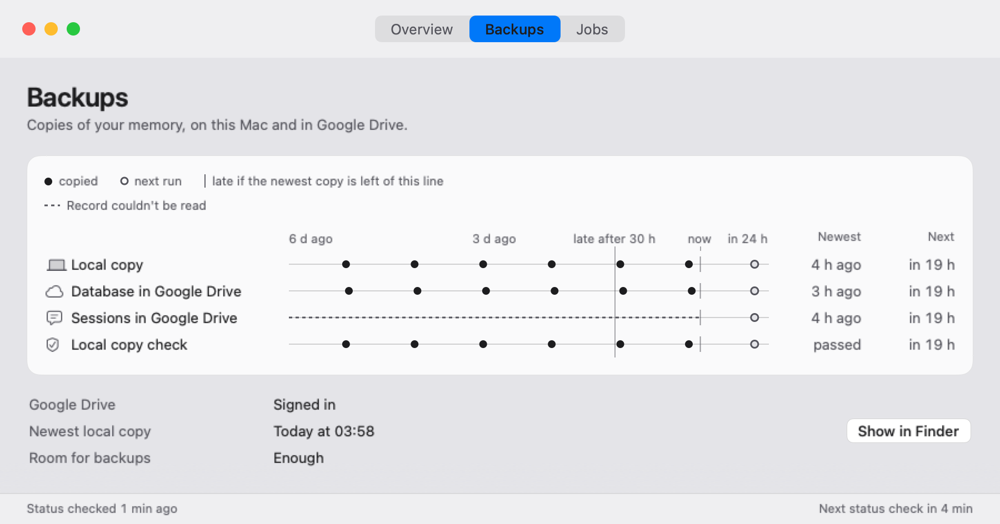
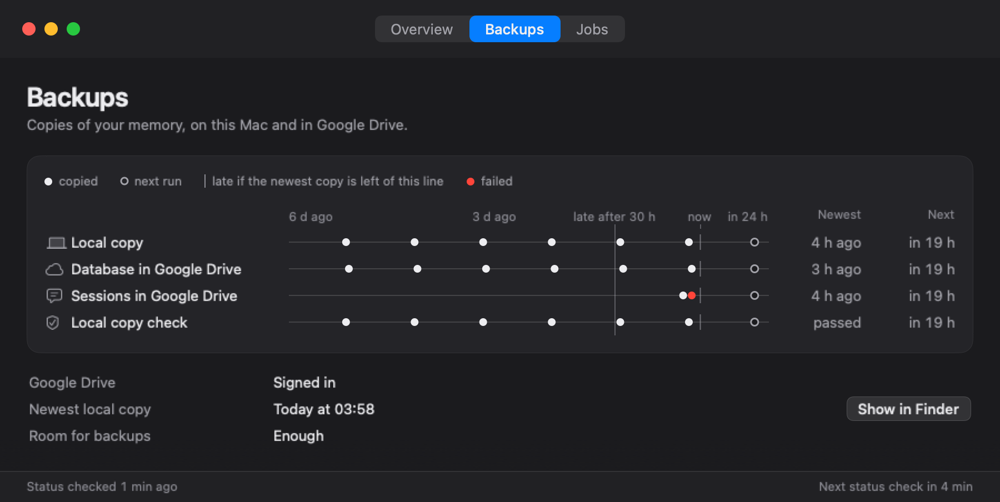
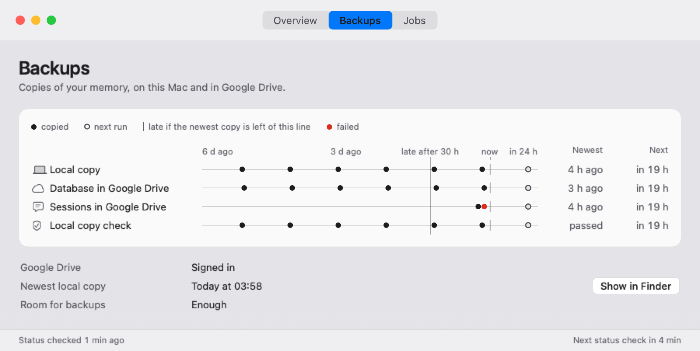

# Sessions backup history: complete state proof

Application source: cda65645b0845d8f96e076c4984f02cd86bf5ebe.
Invented data only; offscreen NDRenderHarness at the real 900-point width,
2x PNGs. No app, window, menu, database, socket or real log opened.

Missing before: empty, unread and failed Sessions history had no picture coverage;
the drawn recent state was already shown.

The new clockless-row rule is exercised with three undated no-op rows followed
by old dated rows, with and without recent attempts. The unread control puts
an undated row between recent attempts. The failed control has a recent failure
after a success, so no successful retry can turn it into a hollow retry ring.
Surrounding lanes and the separate current status snapshot stay fixed.
In particular, an empty attempt history does not erase the independent Newest
cell: it still says 4 h ago. This is empty history, not unread history.

| Sessions state | What draws / legend | Dark (900 pt) | Light (900 pt) |
| --- | --- | --- | --- |
| Legacy head + recent successful runs | Normal rail, two copied dots, next-run ring. Legend: copied; next run; late if the newest copy is left of this line. |  |  |
| Legacy head + no in-window run | Normal hairline rail with no historical dots; next-run ring remains. Newest stays at the independent status snapshot's 4 h ago. Legend: copied; next run; late if the newest copy is left of this line. |  |  |
| Undated row between in-window runs | Dashed unknown rail to now; unread-record legend shown. Legend: copied; next run; late if the newest copy is left of this line; Record couldn't be read. |  |  |
| Failed run in the window | One copied dot and one filled red failed dot; failed legend shown. Legend: copied; next run; late if the newest copy is left of this line; failed. |  |  |

All four states draw differently in each appearance. The harness asserts the
Sessions unknown/ok/fail states, conditional legend entries and real pixel width.
No drawn state required an application change. Product head remains unchanged.

## Repeatable visual regression

The proof-only `BrainBarSessionsStateProofTests.swift` is retained here, outside
the application branch, together with `states/manifest.json` and the eight PNGs.
Copy that harness into `brain-bar/Tests/BrainBarTests/`, set W252_STATE_PROOF to
an absolute scratch output directory, and run `swift test --filter
BrainBarSessionsStateProofTests` using a scratch build under `.build.noindex/`.
Set W252_STATE_BASELINE to this proof's absolute `states/` directory to compare
every drawn PNG byte-for-byte to these published baselines. Remove only the
temporary harness copy afterward. The manifest contains actual legend text,
lane accessibility, event kinds, pixel dimensions and skipped-row counts.

## Original fail-first before/after

Baseline production source: 07720cbbacba43abfb25ca0414eb5dafaf5e0245, with the
regression tests added: six tests, 11 expected assertion failures. Fixed code:
41 focused Swift tests passed, including drawn-page equality to clean history.
The existing eight-day cutoff is unchanged. Installed acceptance remains part
of the lead's release batch.

| Appearance | Before | After |
| --- | --- | --- |
| Dark |  |  |
| Light |  |  |

No animation or interaction changed.
