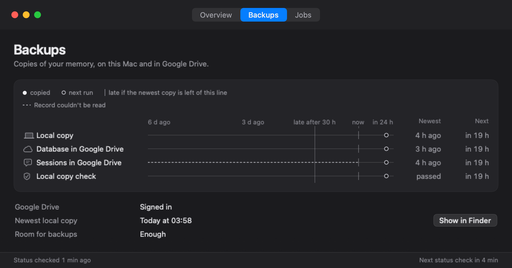
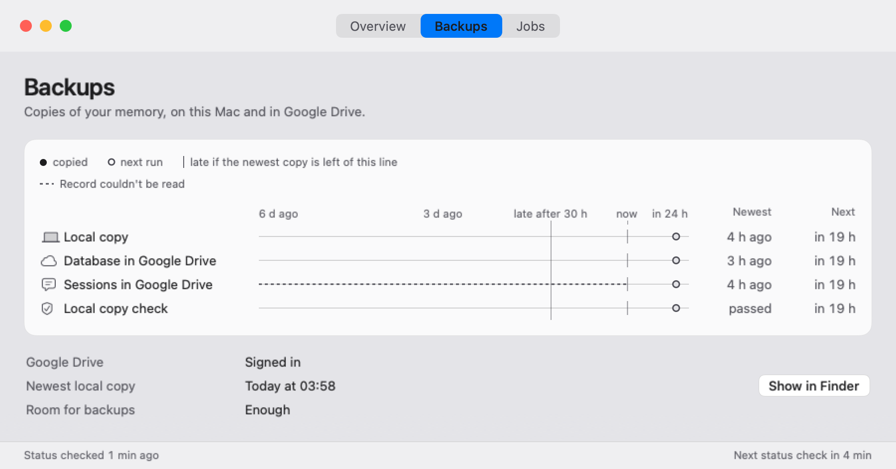

# Sessions legacy backup rows: offscreen proof

Invented data only. Three undated, error-free no-op rows precede two old
dated uploads and two recent successful uploads. No live logs, database,
socket, window or resident application were used.

Baseline: production source at 07720cbbacba43abfb25ca0414eb5dafaf5e0245,
with the new regression test file added. Six tests ran with 11 assertion
failures: the head rows made the lane unknown and both drawn pages matched
the unread state instead of clean history. Recent/EOF damage controls passed.

Fixed: 41 focused tests passed, including byte-identical offscreen PNGs for
the parsed legacy fixture and clean history in both appearances; the same
renders differ from unread history. The reader's existing eight-day cutoff
is unchanged. Non-empty errors, undated EOF/recent rows and malformed rows
remain damage. The database-log parser does not receive the new age bound.

| Appearance | Before | After |
| --- | --- | --- |
| Dark |  |  |
| Light |  |  |

Rendered by BrainBarLegacyBackupRowsTests.testRenderRequestedLegacyHeadProof
through NDRenderHarness.window at the native 900-point window width (2x PNG).
Set LEGACY_BACKUP_PROOF to an absolute output directory and run that focused
Swift test. No animation or interaction changed. Installed-client acceptance
remains part of the lead's release batch.
