# Update control state table

Invented data; Settings row440pt, header900pt, Settings window480pt. Offscreen only. Header is intentionally hidden for rest, up-to-date and Later.
Missing before: transient up-to-date, Later-hidden, both waiting states, cancelling, installer-unavailable, tap-pending, check-failed, pressed/preflight, longest recovery; header previously shown only for offer.

| State | Settings dark | Settings light | Header dark | Header light |
|---|---|---|---|---|
| rest |  |  |  |  |
| up-to-date |  |  |  |  |
| checking |  |  |  |  |
| offer |  |  |  |  |
| offer-pressed |  |  |  |  |
| later |  |  |  |  |
| waiting |  |  |  |  |
| unknown-jobs |  |  |  |  |
| install-preflight | 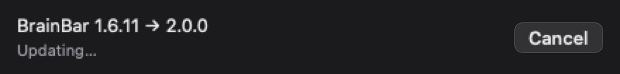 |  | 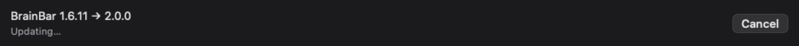 |  |
| installing | 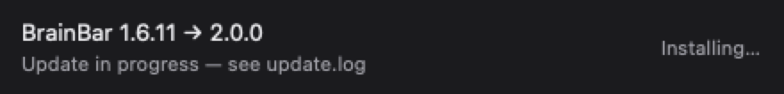 | 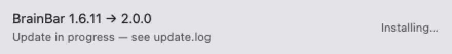 | 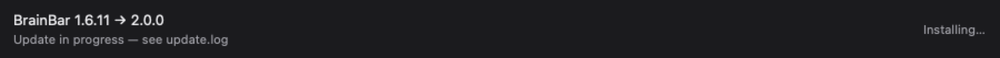 | 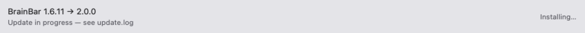 |
| cancelling |  |  |  |  |
| failed-long | 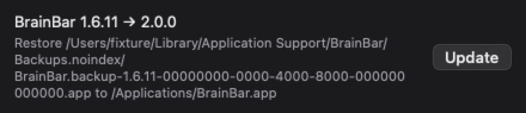 | 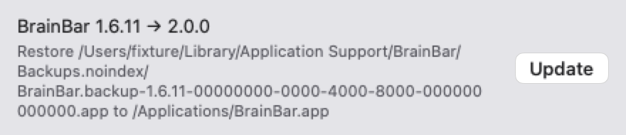 |  |  |
| installer-unavailable | 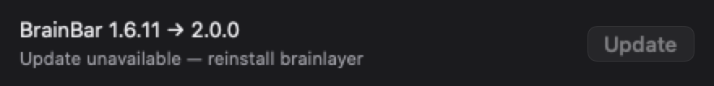 | 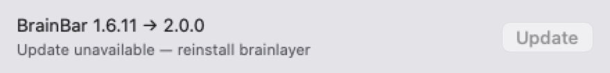 | 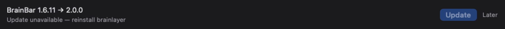 | 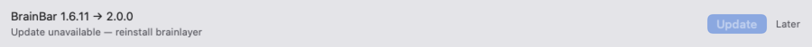 |
| tap-pending |  |  | 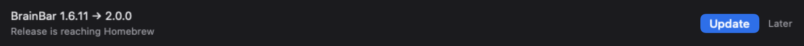 |  |
| check-failed |  |  | 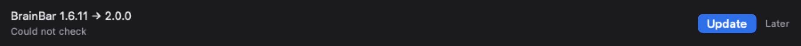 | 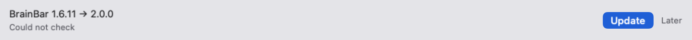 |

## Long recovery in the refitted Settings content (480 pt)

| Dark | Light |
|---|---|
| 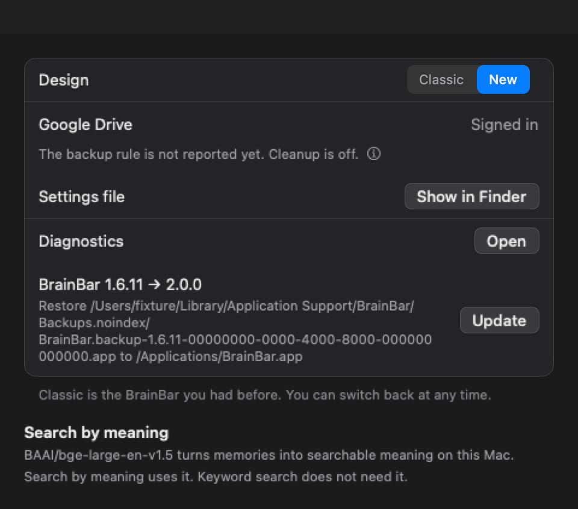 | 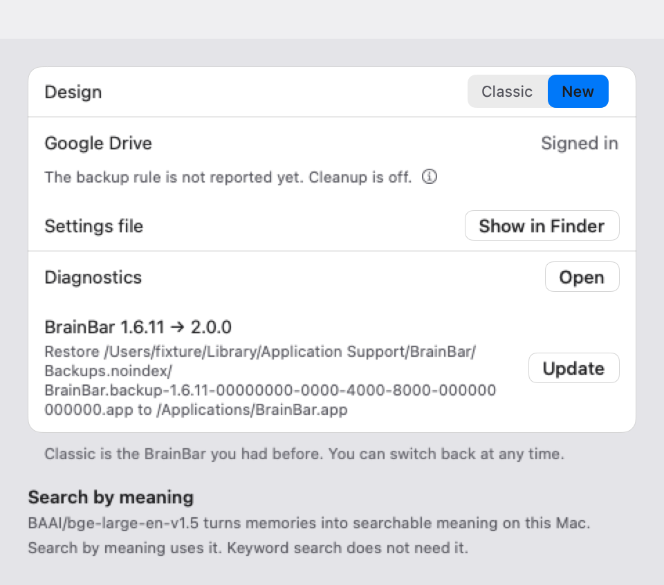 |
