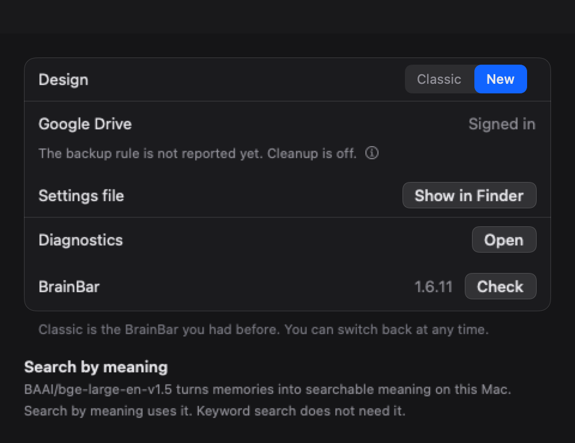
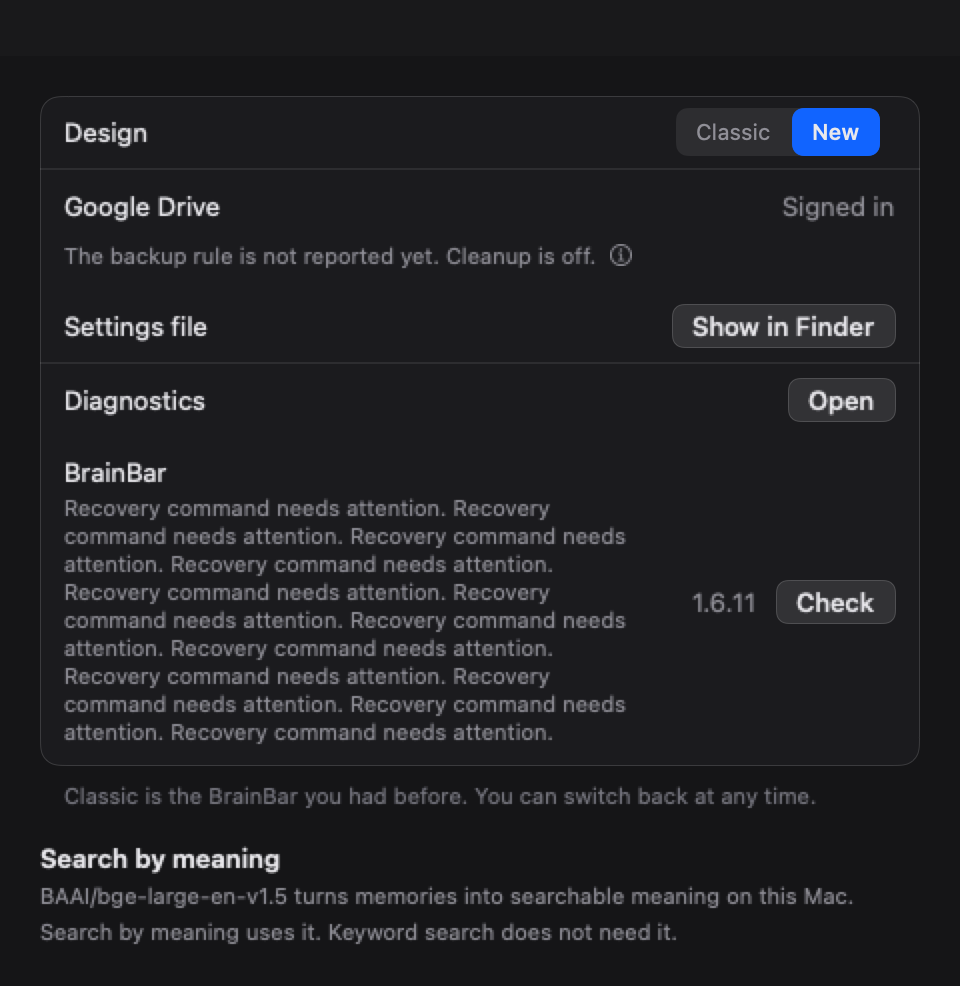

# Settings recovery refit

Invented fixture, same offscreen NSHostingView: idle then multiline recovery. No native window opened. Window resize itself and real updater bootout survival remain M1 release acceptance.

| Before | After |
|---|---|
|  |  |
