# Activity: ingestion and memory reads

Invented data only. Offscreen NDRenderHarness renders of the actual Activity card, 920 pt wide.
The regression test failed on the base with 17 assertions: no call buckets, old ingestion labels.
The after card adds a blue search/recall-call series and a caption using the actual busiest minute.
The hover readout shows counts for its selected bucket, including the third series.
These images do not establish installed-app or live MCP acceptance; those belong to the release batch.

| State | Before | After |
|---|---|---|
| hour, dark, rest | 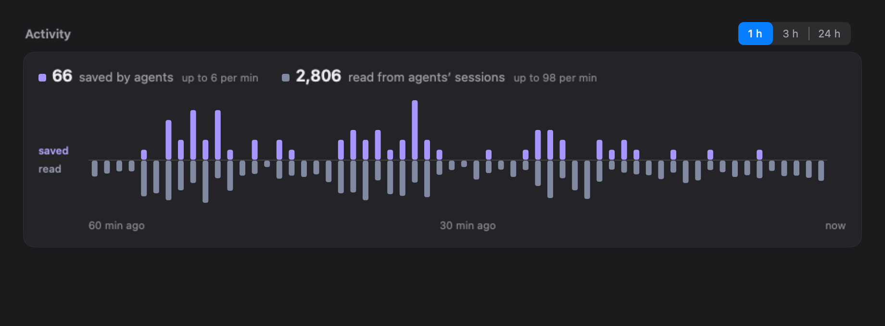 | 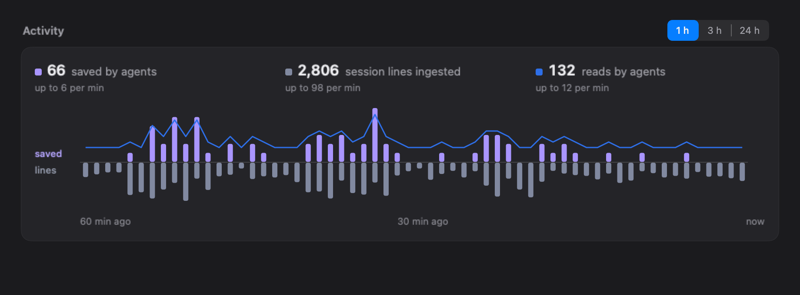 |
| hour, dark, hover | 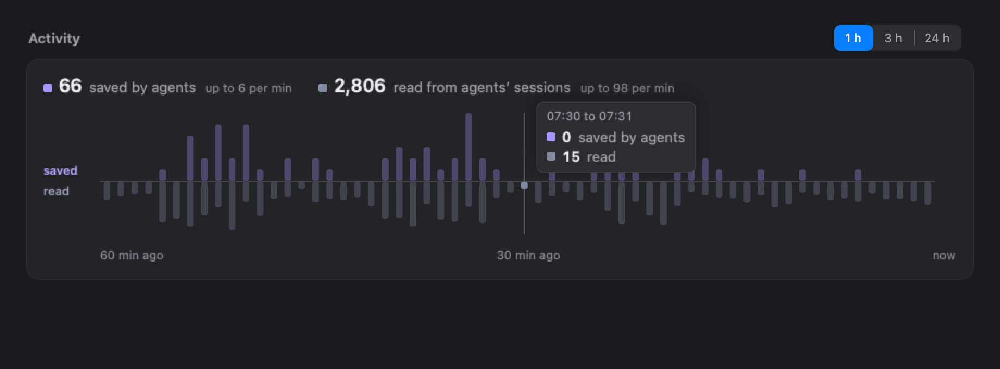 | 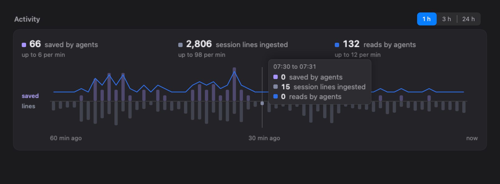 |
| hour, light, rest | 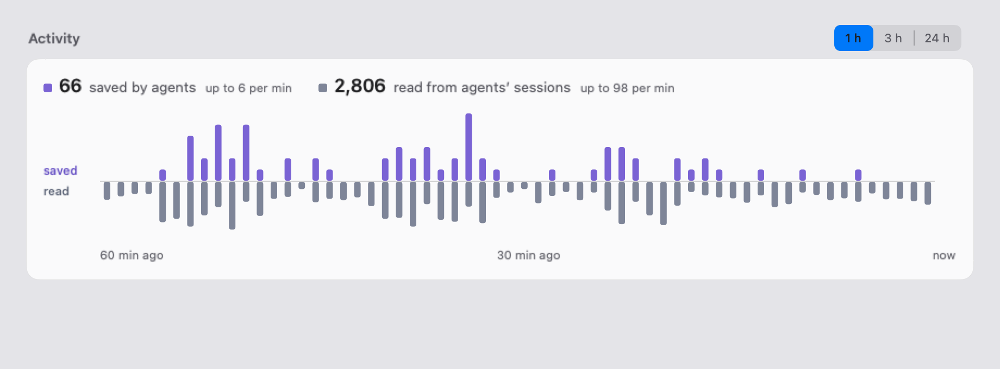 | 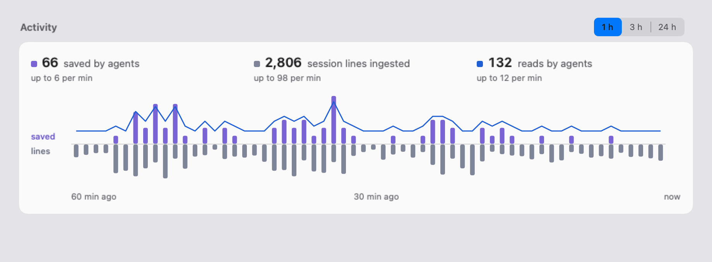 |
| hour, light, hover | 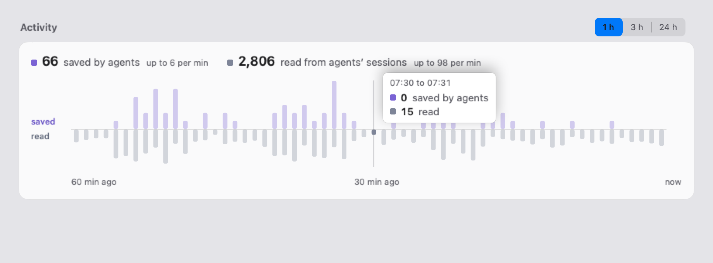 | 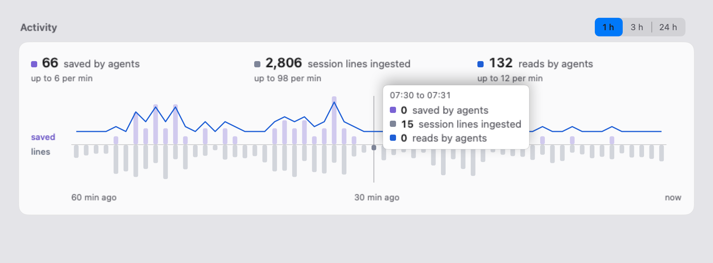 |
| day, dark, rest | 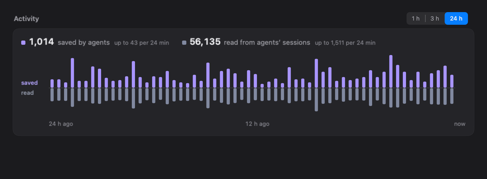 | 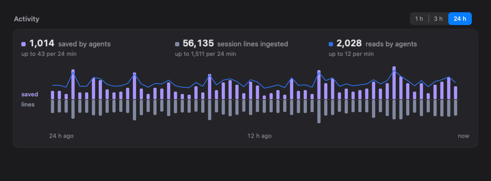 |
| day, dark, hover | 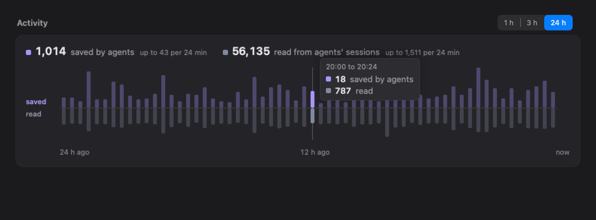 | 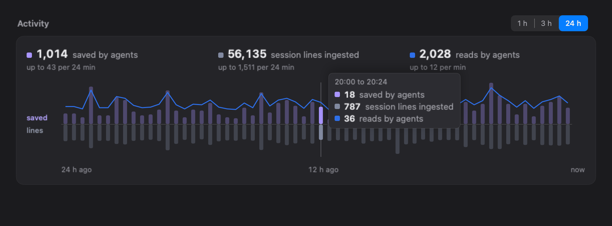 |
| day, light, rest | 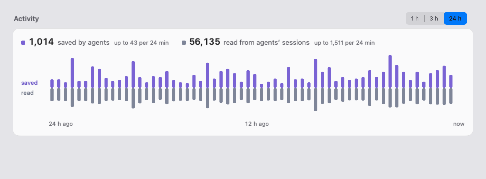 | 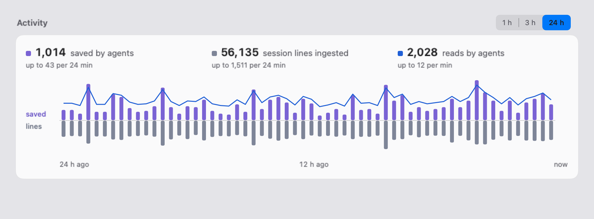 |
| day, light, hover | 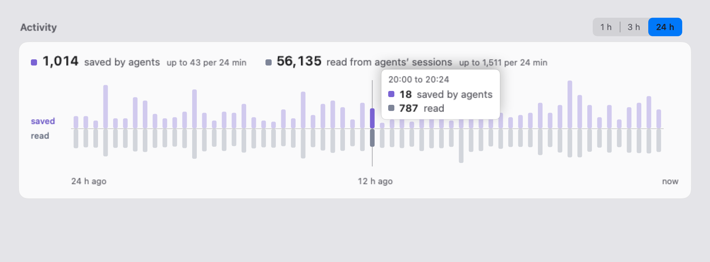 | 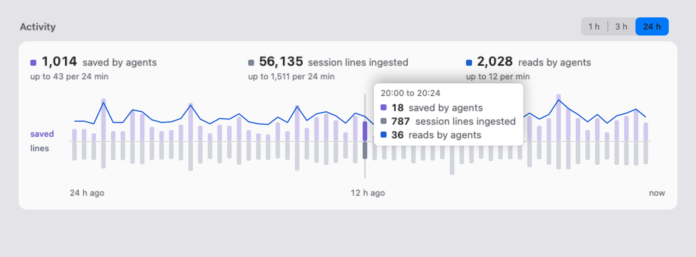 |
